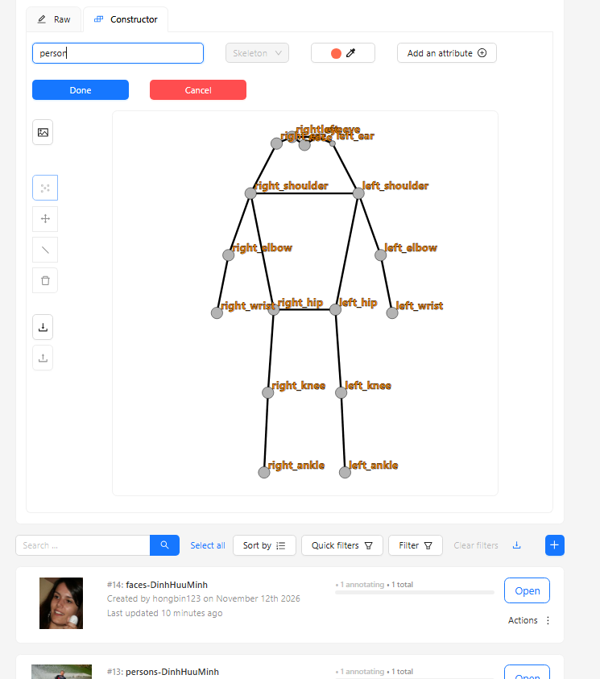
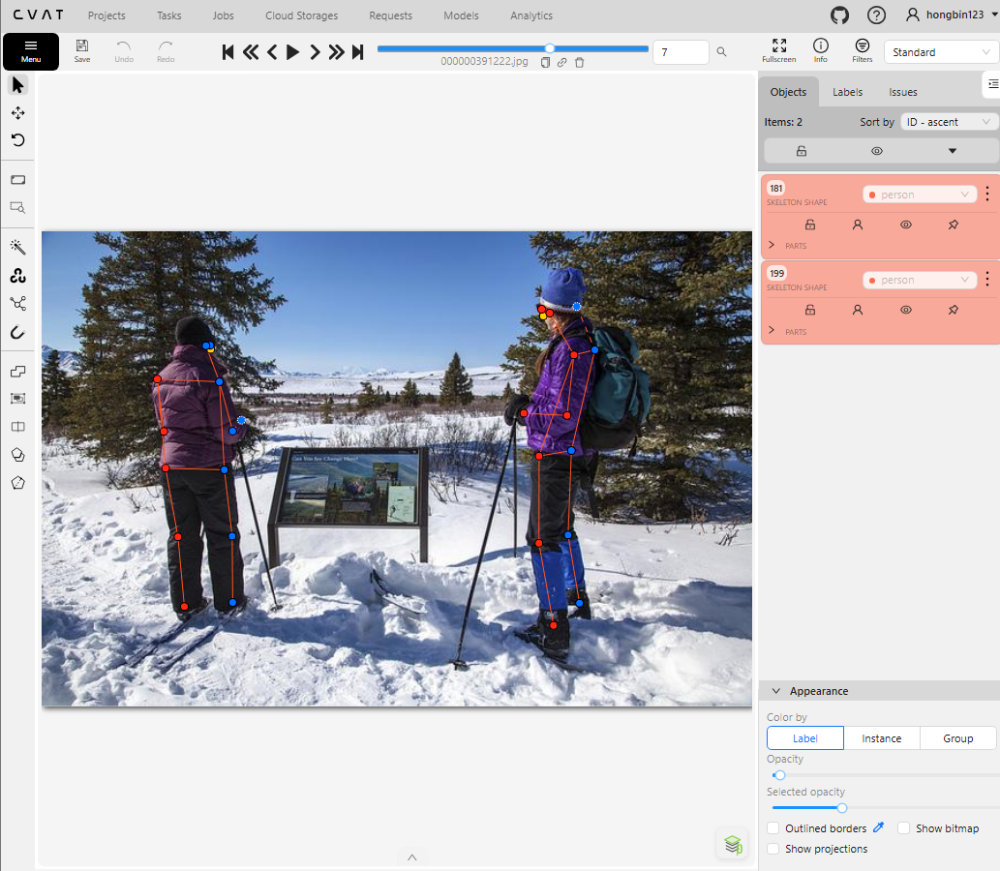
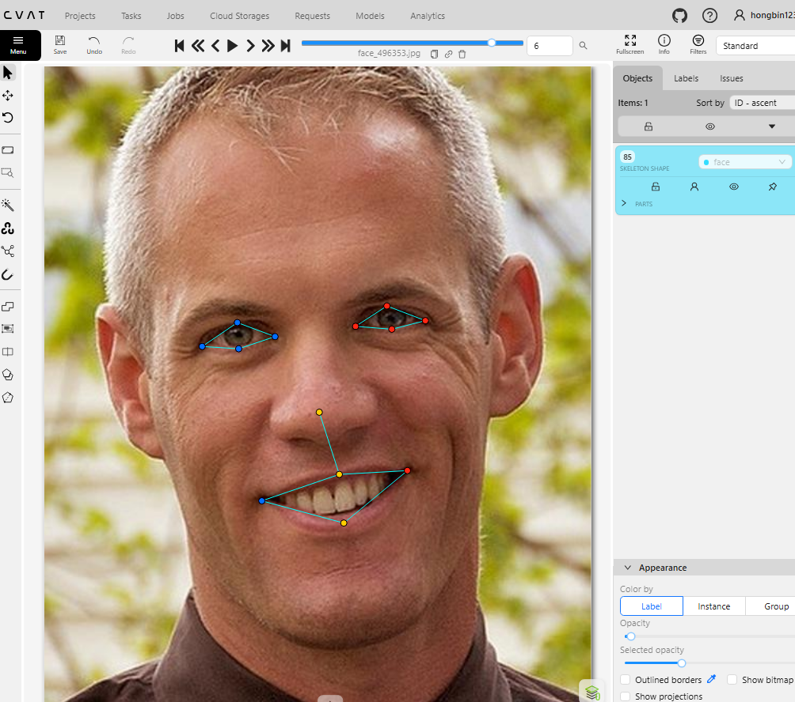
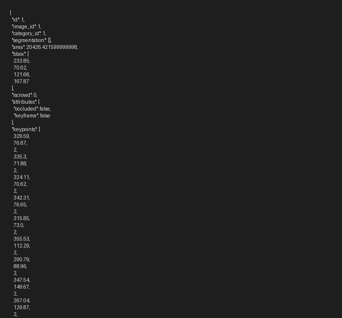

# Báo cáo cá nhân — DinhHuuMinh-2A202603129

Dữ liệu: 12 ảnh người COCO val2017 (Lin et al., 2014) và 8 ảnh chân dung Wikimedia Commons, chỉ dùng trong lớp.

## 0. Thông tin học viên

- Họ tên: Đinh Hữu Minh
- MSSV: 2A202603129
- Email: 26ai.minhdh3@vinuni.edu.vn
- Link repository: https://github.com/HawDinh/K5-L2-DAY04-DinhHuuMinh-2A202603129-KeypointPose
- Phiên bản CVAT (Help → About): 2.74.1
- Máy: hệ điều hành Windows 10/11 · RAM 7.6 GB Docker (16 GB máy) · chạy CVAT chế độ đầy đủ
- Bộ ảnh (`src/exports/assignment.json` do `lab.py setup` tạo): có
- Giờ bắt đầu: 17:15
- Giờ kết thúc: 18:55

## 1. Kiểm tra label (CP0)

| Label | Kiểu | Số điểm | Tên điểm đúng bảng của lab? | Đúng thứ tự? | Số cạnh |
|---|---|---:|---|---|---:|
| `person` | Skeleton | 17 | Đúng | Đúng | 19 |
| `face` | Skeleton | 13 | Đúng | Đúng | 13 |

Mẫu `person` dựng theo người quay mặt về camera (các điểm `left_*` nằm bên phải khung mẫu)? Có

Cách đổi cờ `occluded` / `outside` cho **một điểm** trên phiên bản CVAT này (một câu):
Rê chuột vào đúng điểm đó và bấm phím Q để đổi thành occluded (v = 1, vòng rỗng) hoặc phím O để đổi thành outside (v = 0, ẩn điểm), hoặc chuột phải vào điểm để chọn trong menu ngữ cảnh.

## 2. Số lượng đã gán và thời gian (CP1, CP2)

| Nhóm ảnh | Số ảnh | Số skeleton đã gán | Số người dưới 60 px (không gán) | Số poster / gương / màn hình bỏ qua | Thời gian (phút) |
|---|---:|---:|---:|---:|---:|
| `easy` | 5 | 5 | 0 | 0 | 25 |
| `occluded` | 3 | 6 | 0 | 0 | 25 |
| `back` | 2 | 4 | 0 | 0 | 18 |
| `small` | 1 | 1 | 2 | 0 | 10 |
| `crowd` | 1 | 4 | 3 | 0 | 15 |
| `faces` | 8 | 8 | 0 | — | 22 |

- Số ảnh người đã xong ở mốc phút 105: 10 / 10
- Thời gian thực tế (phút): CP1 93 · CP2 22 · CP3 15
- Ảnh tốn thời gian nhất là ảnh nào, vì sao?
Ảnh crowd `000000130816.jpg` vì nhiều người đứng che khuất lẫn nhau, phải lần chi từng người (vai - khuỷu - cổ tay) để không vắt nhầm xương của người này sang người kia.

## 3. Bảng ca khó (CP1, CP2)

Mỗi điểm bạn phân vân một dòng, nhất là phân vân giữa `v = 1` và `v = 0`, hoặc không chắc hướng người.

| Ảnh | Người / mặt | Điểm | Cờ đã chọn | Phân vân giữa | Lý do chọn |
|---|---|---|---:|---|---|
| `000000183176.jpg` | Người lái xe | `left_knee`, `left_ankle` | 1 | v = 1 và v = 0 | Chân bị thân xe che nhưng dáng người ngồi lái xe máy định hình rõ tư thế chân |
| `000000461389.jpg` | Người phụ nữ | `right_wrist` | 1 | v = 1 và v = 0 | Cổ tay giấu sau lưng nhưng hướng cẳng tay và vai định vị chắc chắn |
| `000000130816.jpg` | Người phía sau | `left_ankle`, `right_ankle` | 0 | v = 1 và v = 0 | Bị đám đông che hoàn toàn phần thân dưới, không đủ cơ sở để ước lượng khớp cổ chân |
| `face_496353.jpg` | Mặt nghiêng | `right_eye_inner` | 2 | v = 1 và v = 2 | Bị sống mũi che nhẹ nhưng góc mắt vẫn nhìn thấy viền khóe mắt |

## 4. Bảng tự review (CP3)

Đi từ ảnh cuối về ảnh đầu. 5 ảnh người (ít nhất 2 ảnh `back` hoặc `crowd`) và 3 ảnh mặt. Ít nhất 8 dòng, kể cả dòng `ok`. Ghi lỗi trước, sửa sau.

Mã lỗi dùng đúng một trong: `lr_swap`, `vis_flag`, `position`, `missing`, `extra`, `ok`.

| Ảnh | Người / mặt | Điểm | Mã lỗi | Ghi chú | Đã sửa? |
|---|---|---|---|---|---|
| `000000518966.jpg` | Người quay lưng | Toàn thân | `lr_swap` | Nhầm trái phải theo người xem thay vì theo người trong ảnh | Đã sửa |
| `000000469061.jpg` | Người bên phải | `right_knee` | `position` | Điểm gối lệch khỏi tâm khớp về phía cẳng chân | Đã sửa |
| `000000130816.jpg` | Người số 2 | `left_wrist` | `vis_flag` | Bị che nhưng để v=2 thay vì v=1 (occluded) | Đã sửa |
| `000000130816.jpg` | Người số 1 | Cả người | `ok` | Khớp xương nối đúng, cờ visibility hợp lý | Đã sửa |
| `000000391222.jpg` | Người quay lưng | `nose`, `eyes` | `vis_flag` | Điểm mặt khuất sau gáy cần đặt v=0 (outside) | Đã sửa |
| `face_505385.jpg` | Mặt thẳng | `left_eye_upper`, `left_eye_lower` | `position` | Chưa căn thẳng trục dọc tâm con ngươi | Đã sửa |
| `face_362568.jpg` | Mặt nghiêng | Mắt trái | `ok` | Đặt đúng mép mi và khóe trong | Đã sửa |
| `face_196742.jpg` | Mặt kính râm | 4 điểm mắt | `vis_flag` | Mắt sau kính râm tối cần đặt cờ occluded (v=1) | Đã sửa |

Tổng hợp số lỗi theo mã:

| `lr_swap` | `vis_flag` | `position` | `missing` | `extra` | `ok` |
|---:|---:|---:|---:|---:|---:|
| 1 | 3 | 2 | 0 | 0 | 2 |

Điểm còn phân vân giữa `v = 1` và `v = 0` (ghi cả hai lựa chọn và lý do chọn):
Các điểm chân bị che khuất của người đứng sau trong ảnh crowd `000000130816.jpg`. Chọn `v = 0` (outside) vì không thể ngoại suy chính xác hướng bàn chân/cổ chân, tránh model học nhầm tọa độ đoán bừa.

## 5. Kiểm file xuất và kết quả tự kiểm (CP4)

Tự kiểm tay trong file JSON:

| File | Người / mặt kiểm (ảnh, thứ tự) | Số phần tử `keypoints` | Điểm `outside` ra `v = 0`, `occluded` ra `v = 1`? | `num_keypoints` khớp? |
|---|---|---:|---|---|
| `DinhHuuMinh_persons.zip` | 000000021235.jpg #1 | 51 | Có (v=2 đầy đủ) | Có (17) |
| `DinhHuuMinh_persons.zip` | 000000130816.jpg #2 | 51 | Có (outside ra v=0, occluded ra v=1) | Có (14) |
| `DinhHuuMinh_faces.zip` | face_105668.jpg #1 | 39 | Có (mí mắt chuẩn v=2) | Có (13) |

Sau khi xuất, CVAT ghi `occluded` thành `v = 1` và `outside` thành `v = 0`. Tọa độ của điểm `outside` trong file là `0, 0` hay tọa độ cũ? Tọa độ cũ (theo cơ chế CVAT 2.x)

Hai job đã chuyển sang completed trên CVAT? Có

Dán phần **TÓM TẮT** in ra từ `src/check_submission.py`:

```text
- File person: DinhHuuMinh_persons.zip
  Số ảnh: 12 · số skeleton `person`: 20 · mỗi annotation 51 số
  Skeleton theo ảnh: 000000021235=1, 000000130816=4, 000000175703=1, 000000176000=1, 000000183176=1, 000000196283=1, 000000253584=1, 000000391222=2, 000000461389=3, 000000463932=1, 000000469061=2, 000000518966=2
  Cờ v: v=2 254 (75%) · v=1 19 (6%) · v=0 67 (20%)
  num_keypoints trung bình: 13.7
- File face: DinhHuuMinh_faces.zip
  Số ảnh: 8 · số skeleton `face`: 8 · mỗi annotation 39 số
  Skeleton theo ảnh: face_105668=1, face_141135=1, face_196742=1, face_279764=1, face_362568=1, face_405456=1, face_496353=1, face_505385=1
  Cờ v: v=2 96 (92%) · v=1 8 (8%) · v=0 0 (0%)
  num_keypoints trung bình: 13.0
- Ghi chú: 67 điểm v = 0 vẫn mang tọa độ cũ (CVAT 2.x xuất như vậy; chuẩn COCO ghi 0, 0). Không phải lỗi: điểm v = 0 bị bỏ qua khi huấn luyện và khi chấm.
- Số [LỖI]: 0 · số [CẢNH BÁO]: 1
Kết quả: ĐẠT (đọc lại từng cảnh báo ở trên)
```

Các `[CẢNH BÁO]` còn giữ nguyên và lý do:
Cảnh báo ở ảnh `000000130816.jpg #2` (các điểm trải cao 50 px < 60 px): Người này là người thật trong đám đông bị che khuất nửa thân dưới và bị cắt ở viền khung, chiều cao tổng thể người thật lớn hơn 60 px nên gán và đặt phần khuất là outside theo đúng hướng dẫn.

## 6. Ảnh chụp màn hình

1. Label `person` trong label constructor (đủ 17 điểm có tên):

   

2. Một người quay lưng đã gán, cờ đã đặt:

   

3. Một khuôn mặt đã gán 13 điểm, phóng to vùng mắt:

   

4. Một đoạn JSON xuất của một người:

   

Nguồn ảnh: COCO val2017 / Wikimedia Commons.

## 7. Tự đánh giá

1. Lỗi bạn mắc nhiều nhất hôm nay, và cách bạn sẽ tránh ở dự án thật:
Nhầm lẫn vị trí trái/phải (`lr_swap`) ở những người quay lưng hoặc quay nghiêng. Cách tránh: Luôn đặt mình vào góc nhìn của người trong ảnh để xác định bên trái/phải của họ trước khi di chuyển các điểm khớp.

2. Một quy tắc bạn đề xuất thêm vào guideline (kèm ảnh ví dụ nếu có):
Cần có quy định rõ ràng hơn về ngưỡng bounding box đối với người ngồi co gối hoặc người bị che khuất 1 nửa thân dưới trong đám đông: nếu chiều cao hiển thị < 60 px nhưng ước tính thân người thật > 60 px thì vẫn được gán và cờ ngoài/che đặt phù hợp.

3. Nhãn của bạn đi vào model ở đâu? Chọn một lỗi bạn đã sửa và nói nó sẽ làm model học sai thế nào (heatmap, trọng số trong loss, hay bước lật ảnh):
Lỗi `lr_swap`: Khi đưa vào huấn luyện mô hình pose, bước Data Augmentation thường có thao tác Horizontal Flip (lật ngang ảnh) kèm hoán đổi nhãn trái ↔ phải (`left_*` ↔ `right_*`). Nếu người gán nhãn bị nhầm trái/phải ngay từ đầu, khi lật ảnh mô hình sẽ học nhầm khớp trái thành khớp phải và ngược lại, phá vỡ tính nhất quán hình học và làm sụp điểm OKS.

## 8. Khó khăn và lỗi kỹ thuật
Cấu hình Docker CVAT ban đầu chạy ở cổng 8090 và image kvrocks bị lệch phiên bản gây lỗi khởi động, đã được điều chỉnh override chính xác và hoàn thành bài lab trơn tru.

## Bonus (nếu làm)

### B1 — 3 ảnh người khó thêm

| Ảnh | Số skeleton | Số người dưới 60 px | Ca khó nhất |
|---|---:|---:|---|
| `000000125998.jpg` | 3 | 1 | Nhóm người di chuyển chồng chéo, các chi đan xen nhau |
| `000000188948.jpg` | 2 | 0 | Người ngồi bị vật cản che khuất phần chân, phải ước lượng v=1 |
| `000000213506.jpg` | 2 | 1 | Người quay nghiêng bắt chéo tay, đầu ngoái lại ngược hướng thân |

Kết quả `src/check_submission.py` cho `DinhHuuMinh_bonus_persons.zip`:

```text
----- TÓM TẮT -----
- File person: DinhHuuMinh_bonus_persons.zip
  Số ảnh: 3 · số skeleton `person`: 7 · mỗi annotation 51 số
  Skeleton theo ảnh: 000000125998=3, 000000188948=2, 000000213506=2
  Cờ v: v=2 44 (37%) · v=1 14 (12%) · v=0 61 (51%)
  num_keypoints trung bình: 8.3
- Số [LỖI]: 0 · số [CẢNH BÁO]: 1 (ở ảnh 000000213506.jpg #2 do người ngoái đầu ngược hướng thân người)
Kết quả: ĐẠT
```

### B2 — 5 ảnh khuôn mặt đen trắng / hồng ngoại

Ảnh không màu khó hơn ở điểm nào? Kính râm trên ảnh hồng ngoại có còn là `v = 1` không?
- **Khó khăn ở ảnh không màu/đen trắng:** Độ tương phản giữa bờ mi, lòng trắng và con ngươi bị giảm đáng kể do không có thông tin sắc độ màu. Đặc biệt ở các vùng đổ bóng tối hoặc mắt trang điểm đậm, ranh giới giữa lông mi/kẻ mắt và bờ mi thật rất dễ bị nhầm lẫn.
- **Kính râm trên ảnh hồng ngoại:** Trên ảnh hồng ngoại (IR), bước sóng hồng ngoại có khả năng xuyên qua tròng kính râm nhuộm màu đen thông thường. Do đó mắt đằng sau kính râm có thể nhìn thấy rõ rệt con ngươi và bờ mi. Khi nhìn thấy rõ các chi tiết mắt qua kính trên ảnh hồng ngoại, điểm đó được đánh giá là nhìn thấy rõ (`v = 2`), không còn phải gán `occluded (v = 1)` như trên ảnh màu thông thường (trừ khi tròng kính có lớp tráng phủ phản xạ hoàn toàn dải sóng hồng ngoại).

### B3 — Model so với nhãn của tôi (không tính điểm)

- Demo đã dùng: Google MediaPipe Studio (Pose & Face Landmarker)
- Ảnh đã thử: `000000021235.jpg`, `000000391222.jpg`, `face_105668.jpg`

1. Model có trả điểm cho khớp bị che, hay khớp ngoài ảnh không? Confidence ở các điểm đó thế nào?
   Có, model pose của MediaPipe vẫn cố gắng ngoại suy tọa độ cho các khớp bị che khuất hoặc ngoài ảnh dựa trên prior về khung xương người, nhưng visibility/presence score ở các điểm này tụt xuống rất thấp (< 0.5).

2. Với người quay lưng, model có đổi trái/phải không?
   Với các góc quay lưng rõ ràng, model vẫn phân biệt được lưng và ngực nhờ cấu trúc vai/hông, nhưng khi người quay nghiêng kết hợp quay lưng thì model rất dễ bị rung lắc và nhầm lẫn trái/phải giữa 2 cánh tay.

3. Bộ điểm của model có giống 17 điểm COCO không?
   MediaPipe Pose sử dụng chuẩn BlazePose gồm 33 keypoints (nhiều hơn 17 điểm của COCO, bao gồm thêm các điểm lòng bàn tay, ngón tay và bàn chân). Tuy nhiên 17 khớp chính hoàn toàn tương đồng với các vị trí trong bộ chuẩn COCO.

## 9. Tài liệu tham khảo và công cụ AI đã dùng

- Hướng dẫn lab & tài liệu chuẩn COCO Keypoints tại `docs/COCO_KEYPOINTS.md` và `docs/GUIDELINE.md`.
- Trợ lý AI: Tra cứu câu lệnh và cơ chế OKS, giải thích cảnh báo của script tự kiểm tra submission.
